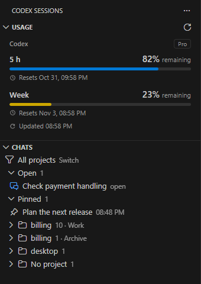
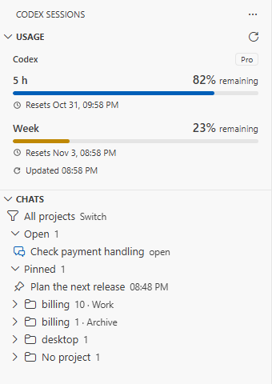

# ThreadShelf for Codex

Open Codex chats in editor tabs. Browse history by project and check account usage from the VS Code sidebar.

An independent extension by **MrKarmannik**. It is not an OpenAI product and is not affiliated with OpenAI.

[Русский](README.ru.md)



## Windows path matching fork

This fork targets Windows project history when a workspace is opened through
a directory symbolic link or junction. The goal is for **This project** and
project grouping to recognize the link and its target as the same folder,
while keeping distinct siblings and subfolders separate.

The Windows development checkout uses `C:\Projects\ThreadShelf`. The Git
remote `origin` points to the [fork](https://github.com/ezfine/codex-session-tabs).
The remote `upstream` points to the [original repository](https://github.com/mrkarmannik/codex-session-tabs).

In PowerShell, use Node.js 22 or newer to run the standalone checks.

```powershell
Set-Location -LiteralPath 'C:\Projects\ThreadShelf'
npm test
```

See the [development guide](docs/development.md) for installing build
dependencies and running an isolated Extension Development Host.

- [AGENTS.md](AGENTS.md) describes the project workflow for Codex.
- [CLAUDE.md](CLAUDE.md) is the Claude entry point.
- [HANDOVER.md](HANDOVER.md) records the current state, verification and next steps.

## Requirements

- Windows x64 and VS Code **1.111.0 or newer** for this preview.
- The official [OpenAI Codex extension](https://marketplace.visualstudio.com/items?itemName=openai.chatgpt), signed in to your account. It is included as an extension pack dependency.

The current compatibility check uses OpenAI Codex **26.1021.22027**. Chat tabs use its internal conversation editor; future Codex updates may require an update to this extension.

## Use

1. Open a project folder and select **ThreadShelf** in the Activity Bar.
2. Select a chat to open it in a pinned editor tab. Selecting it again returns to the existing tab.
3. Click **All projects / This project** above the list to switch the history filter. Projects are ordered by their latest loaded chat; expand a project to see its chats.

Open tabs and pinned chats appear first. Hover over the Chats header for new chat, search, refresh, and collapse actions. Right-click a chat to rename it or generate a title. Loading more history adds older chats to their projects.

| Shortcut | Action |
| --- | --- |
| `Ctrl+Alt+H` | Open searchable chat history |
| `Ctrl+Alt+N` | Create a chat in an editor tab |
| `Ctrl+Alt+C` | Return to the last chat |

The extension does not replace VS Code's `Ctrl+Shift+T` editor history. **Codex: Reopen closed chat** is also available from the Command Palette.

## Settings

Open **Settings → Extensions → ThreadShelf for Codex**, or choose **Open extension settings** from the Chats menu.

| Setting | Default | Purpose |
| --- | --- | --- |
| Chat Mode | Graphical chat | Use the official editor, or run Codex CLI in editor terminals |
| Language | Automatic | Follow VS Code's language, or choose English or Russian |
| Generate Titles | On | Name terminal chats from their first message using a short model request |
| Title Model | `gpt-6-luna` | Model used for generated titles |
| CLI Path | Automatic | Optional path to the Codex executable for terminal chats |

**Title generation uses your Codex account and consumes its model allowance.** Disable Generate Titles to stop automatic requests. Manually selecting Generate chat title also sends a model request. Opening history, searching, and reading account limits do not send messages to a model.

The terminal mode runs `codex resume` directly, without passing commands through a shell. It uses your existing Codex configuration; this extension does not increase permissions.

## Limits and privacy

Usage bars show the remaining allowance reported by Codex, with reset times. Only quota windows returned by the service are shown. The visible sidebar refreshes once a minute; the refresh action checks immediately.

Chat history is provided by the local Codex app-server. Pins and view preferences are stored in VS Code. This extension has no telemetry or separate backend. Model requests and account access go through Codex. See [PRIVACY.md](PRIVACY.md) for details.



## Known limitations

- Graphical tab titles are controlled by the official Codex editor. A saved rename may require closing and reopening the tab. This extension does not close chats to update a caption.
- A conversation can have an active writer in another window. Finish work there before opening it for writing here.
- Search and project ordering apply to loaded history. Use **Load more sessions** to include older chats.
- Folder matching is exact after path normalization: Windows drive case, separators, UNC and extended paths are handled; sibling folders and subfolders are separate projects.
- This first public preview is packaged for Windows x64. Other platforms, Remote SSH and WSL are not part of its tested support scope.

## Updating from local builds

The public extension ID is `MrKarmannik.codex-session-tabs`. Uninstall or disable older `local-tools.codex-session-tabs` builds before using it: both versions register the same commands. Codex conversations remain in Codex, but extension-specific pins and closed-tab preferences are not migrated between publisher IDs.

## Support and development

Report a reproducible issue at [GitHub Issues](https://github.com/mrkarmannik/codex-session-tabs/issues). Include the VS Code and Codex extension versions, OS, and steps to reproduce. Do not attach tokens, `auth.json`, or private chat text.

Development instructions are in [DEVELOPMENT.md](https://github.com/mrkarmannik/codex-session-tabs/blob/main/docs/development.md). Licensed under [MIT](LICENSE).
