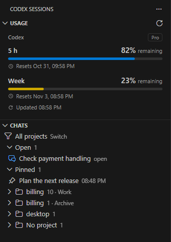

# ThreadShelf for Codex

Чаты Codex во вкладках редактора, история по проектам и лимиты аккаунта в боковой панели VS Code.

Независимое расширение **MrKarmannik**. Не является продуктом OpenAI и не связано с OpenAI.

[English](README.md)

## Требования

- Windows x64 и VS Code **1.111.0 или новее** для этой предварительной версии.
- Официальное [расширение OpenAI Codex](https://marketplace.visualstudio.com/items?itemName=openai.chatgpt) с выполненным входом. Оно включено в набор устанавливаемых расширений.

Совместимость проверяется с OpenAI Codex **26.1021.22027**. Графические вкладки используют его внутренний редактор разговоров; обновление Codex может потребовать обновления надстройки.

## Как пользоваться

1. Открой папку проекта и выбери **ThreadShelf** в Activity Bar.
2. Нажми на чат, чтобы открыть его закреплённой вкладкой. Повторный выбор вернёт к уже открытой вкладке.
3. Строка **Все проекты / Этот проект** над списком переключает фильтр. Проекты упорядочены по последним загруженным чатам; раскрой проект, чтобы увидеть его историю.

Открытые и закреплённые чаты показаны сверху. В заголовке списка доступны создание чата, поиск, обновление и сворачивание групп. Переименование и генерация названия находятся в контекстном меню чата. «Загрузить ещё» добавляет старые чаты в их проекты.

| Клавиши | Действие |
| --- | --- |
| `Ctrl+Alt+H` | История с поиском |
| `Ctrl+Alt+N` | Новый чат во вкладке |
| `Ctrl+Alt+C` | Вернуться к последнему чату |

Сочетание `Ctrl+Shift+T` остаётся штатной историей редакторов VS Code. Для чатов также есть отдельная команда восстановления закрытой вкладки в палитре.

## Настройки

Открой **Settings → Extensions → ThreadShelf for Codex** или выбери **Открыть настройки расширения** в меню списка чатов.

- **Chat Mode** — графический чат по умолчанию или Codex CLI в терминальных вкладках.
- **Language** — автоматически по VS Code, English или Русский. Язык названий команд и настроек определяет сам VS Code.
- **Generate Titles** — автоматически называть терминальные чаты по первому сообщению.
- **Title Model** — модель для названий; по умолчанию `gpt-6-luna`.
- **CLI Path** — необязательный путь к исполняемому файлу Codex для терминальных чатов.

**Генерация названий отправляет короткий запрос модели через текущий аккаунт Codex и расходует его лимит.** Её можно отключить. Ручная команда генерации также отправляет запрос. История, поиск и чтение лимитов не отправляют сообщения модели.

Терминальный режим запускает `codex resume` напрямую и использует существующую конфигурацию Codex. Надстройка не повышает разрешения.

## Лимиты и данные

Полосы показывают остаток лимита и время сброса. Отображаются только окна, которые вернул Codex. Видимая панель обновляется раз в минуту; команда обновления запрашивает данные сразу.

История поступает из локального Codex app-server. Закрепления и настройки представления сохраняются в VS Code. У надстройки нет телеметрии и собственного сервера. Обращения к аккаунту и модели выполняются через Codex. Подробнее — [PRIVACY.md](PRIVACY.md).

## Ограничения

- Заголовком графической вкладки управляет официальный Codex. После переименования может потребоваться закрыть и открыть её заново; надстройка не закрывает чаты автоматически.
- Если разговор занят другим клиентом, сначала заверши работу с ним в другом окне.
- Поиск и порядок проектов относятся к загруженной истории. Для старых чатов используй «Загрузить ещё».
- В Windows путь с буквой диска через символьную ссылку или точку соединения считается эквивалентным пути к целевой папке. Если путь недоступен или указан в формате UNC, сравниваются нормализованные строки путей. Соседние и вложенные папки считаются отдельными проектами.
- Эта версия распространяется для Windows x64. Другие платформы, Remote SSH и WSL не входят в проверенную область поддержки.

## Переход с локальных сборок

Новый ID — `MrKarmannik.codex-session-tabs`. Перед использованием отключи или удали старое `local-tools.codex-session-tabs`: версии регистрируют одинаковые команды. Переписки остаются в Codex; закрепления и история закрытых вкладок надстройки между издателями не переносятся.

## Обратная связь

[GitHub Issues](https://github.com/mrkarmannik/codex-session-tabs/issues). Укажи версии VS Code и Codex, ОС и шаги воспроизведения. Не публикуй токены, `auth.json` и личные переписки.

Лицензия — [MIT](LICENSE).
